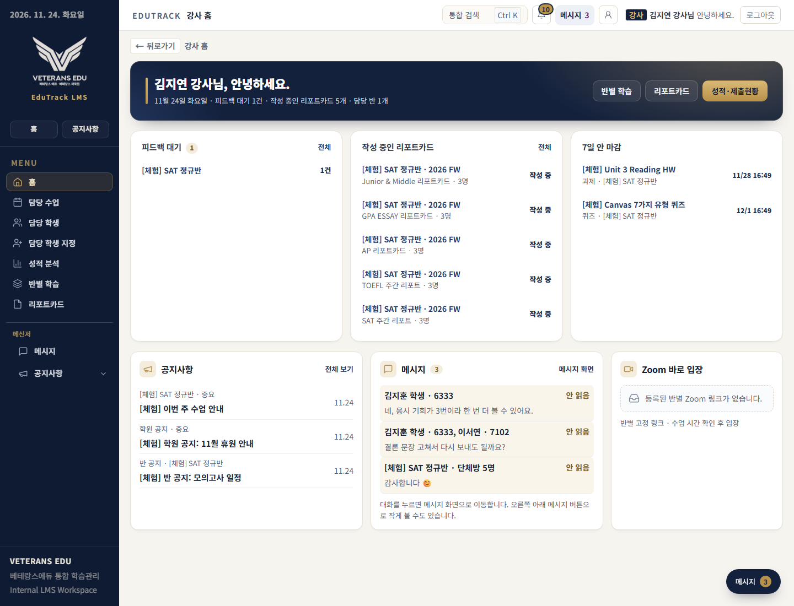
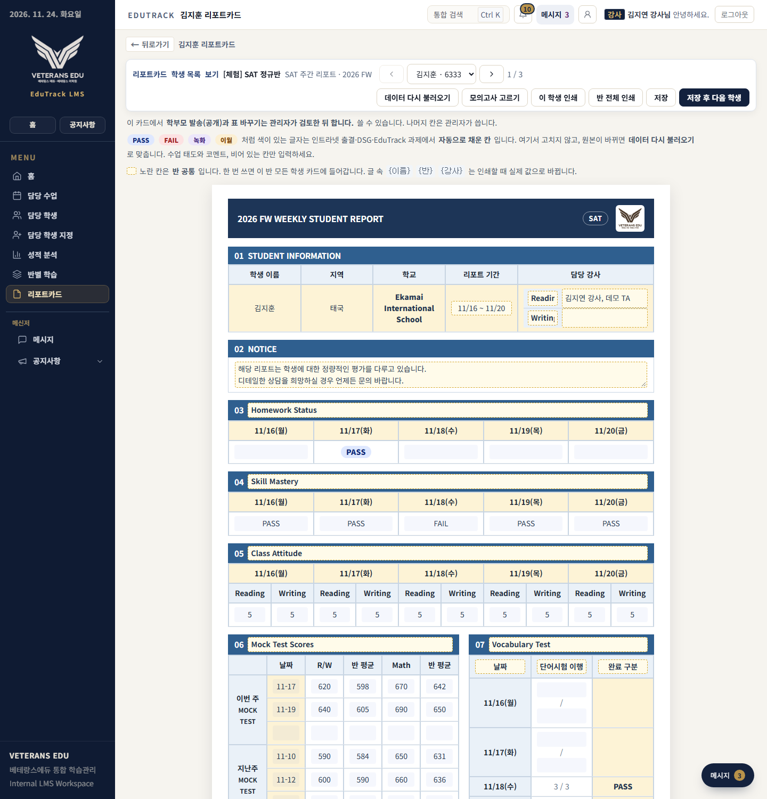
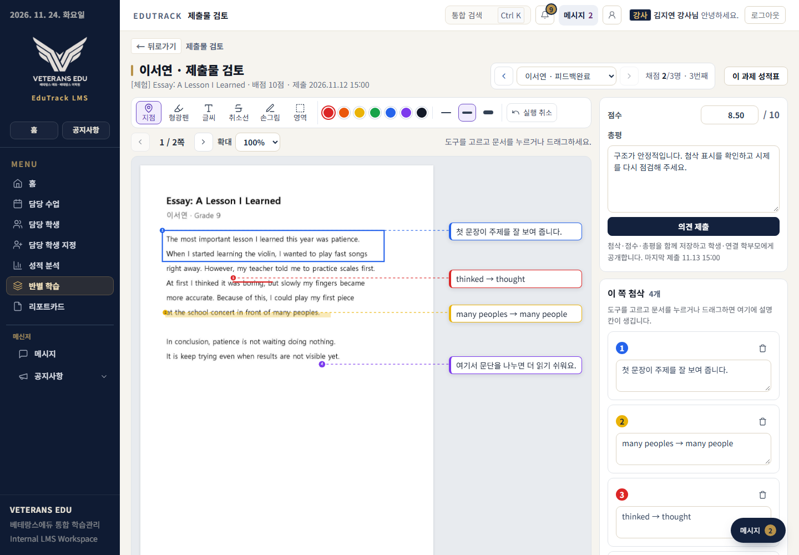
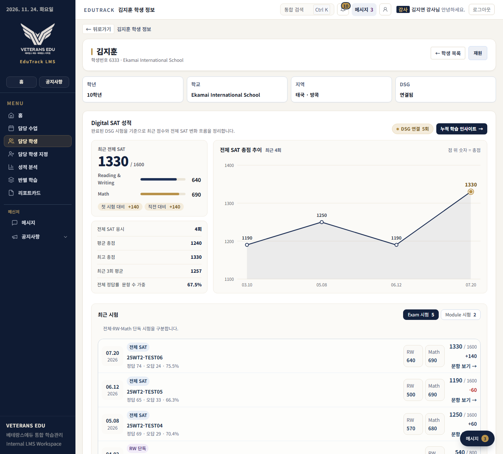
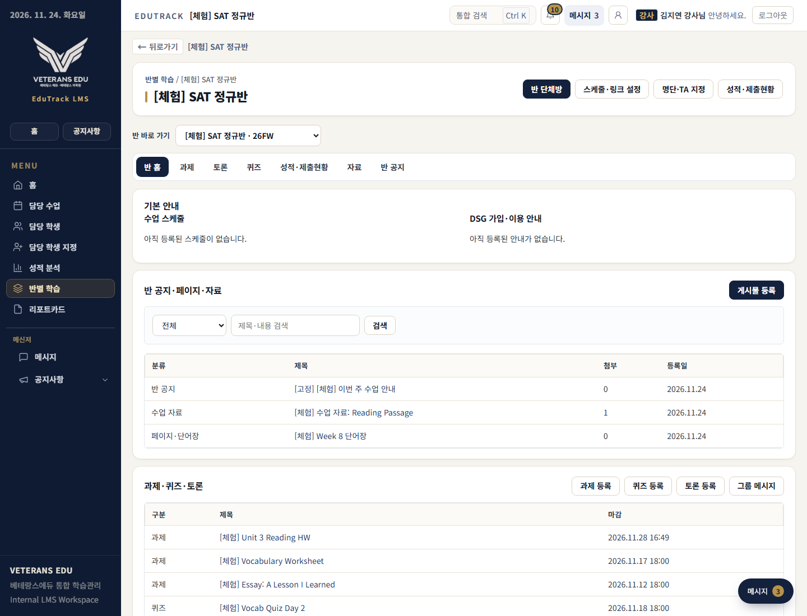
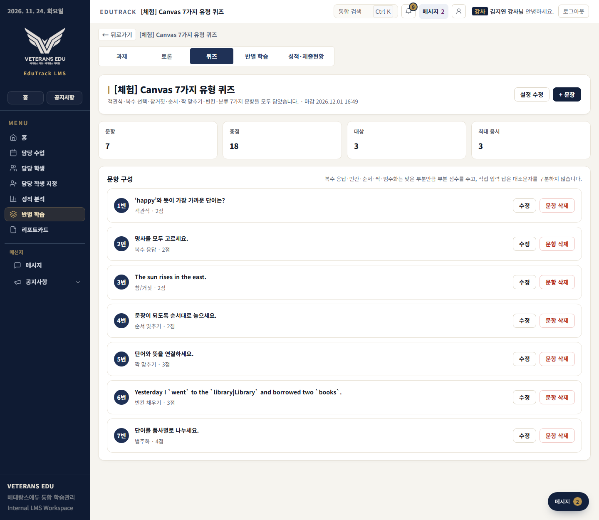
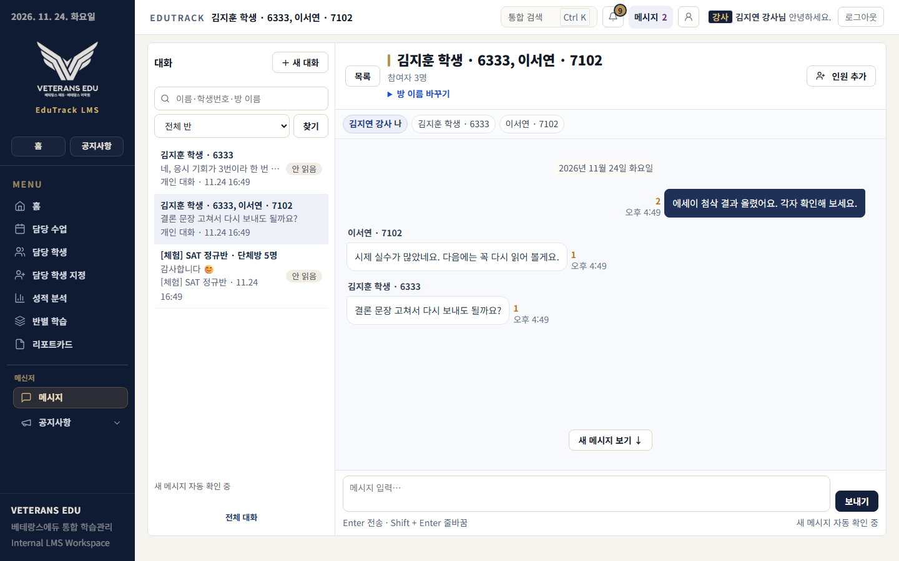
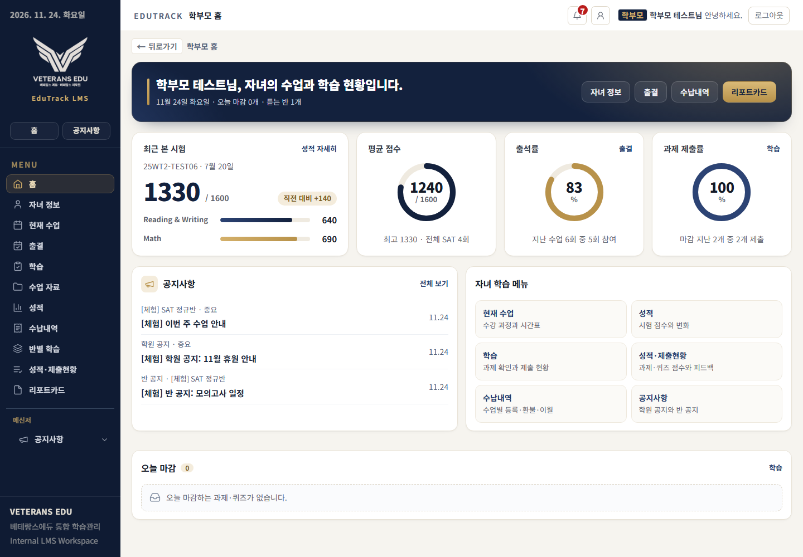

# EduTrack — 학원 통합 학습관리 시스템(LMS)

> 유학·입시 학원(베테랑스에듀)의 관리자·강사·TA·학생·학부모가 **한 사이트에서** 수업·출결·성적·과제·첨삭·메시지·리포트카드를 다루도록 만든 Django 웹 서비스입니다.
> 기획부터 개발, 사내 서버 배포, 운영팀 피드백 반영까지 **혼자** 맡아 진행하고 있습니다.



| 항목 | 내용 |
|---|---|
| 기간 | 2026.07 ~ 진행 중 (실제 사내 서버에서 운영팀이 사용 중) |
| 역할 | 1인 기획·개발·배포·운영 (운영팀 요청 수집 → 우선순위 정리 → 구현 → 검증 → 배포) |
| 규모 | 기능 앱 13개 · DB 모델 40여 개 · 화면 주소 160여 개 · 커밋 129개 |
| 품질 | 자동 테스트 **1,131개** (이 공개본에서는 사내 DB 연동 테스트를 빼서 1,086개) |
| 기술 | Python 3.12 · Django 5.2 LTS · SQLite(WAL) · MySQL/MariaDB(읽기 전용) · waitress · WhiteNoise · Pillow · pypdfium2 · 순수 JS/CSS |
| 개발 방식 | AI 코딩 도구(ChatGPT·Claude)를 활용해 개발하고, 요구사항 정리·설계 판단·테스트 검증·배포는 직접 했습니다. |

> **공개용 사본입니다.** 회사 내부 DB(인트라넷·모의고사 시스템) 연동 코드와 사내 서버 설정, 실제 학생 정보는 모두 뺐습니다.
> 화면과 테스트는 코드 안의 **가짜 자료(demo)** 로 똑같이 동작합니다. → [공개본에서 뺀 것](#공개본에서-뺀-것)

---

## 왜 만들었나

학원에서는 학생 정보·수업·출결·수납은 외주 개발사의 **인트라넷**에, 모의고사 성적은 별도 **DSG(Digital SAT) 시스템**에, 과제·공지·상담은 메신저와 문서 파일에 흩어져 있었습니다.

- 강사는 리포트카드 한 장을 쓰려고 출결·과제·모의고사 점수를 여러 화면에서 손으로 옮겨 적어야 했고,
- 학생·학부모는 과제, 첨삭 결과, 성적을 한곳에서 볼 수 없었습니다.

**EduTrack은 기존 시스템을 바꾸지 않고(읽기만 하고) 그 위에 학습 공간을 얹는 방식**으로 이 문제를 풀었습니다. 학생·수업·성적은 원래 시스템에서 읽어 오고, 과제·첨삭·메시지·리포트카드처럼 새로 생기는 자료만 EduTrack 자체 DB에 저장합니다.

## 주요 기능

### 1. 리포트카드 자동 작성: 코멘트만 쓰면 끝


- **5가지 양식**: SAT 주간, TOEFL 주간, AP, GPA·ESSAY, Junior & Middle
- 출결(PASS·FAIL·녹화·이월), 과제 제출, 단어 시험, DSG 모의고사 점수와 반 평균을 **원본 시스템에서 자동으로 채웁니다.**
- 자동으로 채운 칸은 **색으로 표시하고 잠가서** 손으로 고칠 수 없게 했습니다. 원본이 바뀌면 "데이터 다시 불러오기"로 맞춥니다.
- "모의고사 고르기"에서 시험 날짜·종류·응시 횟수를 보고 이번 주·지난주 시험을 직접 고를 수 있습니다.
- 반 공통 칸(노란 칸)은 한 번 쓰면 반 전체 카드에 들어가고, `{이름}` `{반}` `{강사}` 같은 자리 표시를 인쇄할 때 실제 값으로 바꿉니다.
- 반 전체 인쇄, 관리자 검토 뒤 학부모 공개, 공개 알림까지 이어집니다.

### 2. 제출물 첨삭: 브라우저에서 바로 표시하고 설명 달기


- 학생이 낸 PDF·이미지는 바로, Word·PowerPoint·Excel 문서는 PDF로 바꾼 뒤 페이지 이미지로 만들어 **브라우저에서 바로 첨삭**합니다.
- 도구 6가지: 지점, 형광펜, 글씨, 취소선, 손그림, 영역. 색과 굵기를 고를 수 있고 실행 취소를 지원합니다.
- PDF의 **글자 위치를 읽어** 형광펜·취소선이 드래그한 글자에만 정확히 붙습니다.
- 설명은 문서 밖 오른쪽 여백에 번호와 같은 높이로 놓고 점선으로 이어서, 본문을 가리지 않습니다.
- 점수·총평·첨삭을 한 번에 저장하면 학생과 연결된 학부모에게 공개됩니다.
- 문서 변환은 별도 프로세스(subprocess)로 돌려, 잘못된 파일이 들어와도 웹 서버가 멈추지 않게 했습니다.

### 3. 학생 성적 분석 (DSG 모의고사)


- 최근 점수, RW·Math 비율, 첫 시험·직전 대비 변화, 총점 추이 그래프
- Exam 시험과 Module 시험을 나눠 보여 주고, 시험별 문항 단위 정답·오답과 학습 인사이트(약한 유형)를 제공합니다.
- 무거운 분석은 캐시해서 같은 화면을 다시 열 때 빠르게 뜹니다.

### 4. 반별 학습 공간


- 반 하나에 과제·토론·퀴즈·자료·반 공지·단체방을 모았습니다(반 홈 탭).
- 반을 만들 때 **인트라넷 클래스를 고르면 수강생이 한 번에 나오고**, 전체 등록하거나 검색해서 한 명씩 넣고 뺄 수 있습니다. Term도 인트라넷 목록에서 고릅니다.
- 강사·TA를 지정하면 그 반 학생만 볼 수 있습니다.

### 5. 퀴즈 7가지 유형


- 객관식, 복수 응답, 참/거짓, 순서 맞추기, 짝 맞추기, 빈칸 채우기, 범주화
- 복수 응답·빈칸·순서·짝·범주화는 맞은 만큼 **부분 점수**를 주고, 응시 횟수 제한·마감·성적표를 지원합니다.

### 6. 메신저와 학부모 포털
| 메신저 | 학부모 홈 |
|---|---|
|  |  |

- 1:1, 그룹, 반 단체방, 읽음 표시, 새 메시지 자동 확인, 모든 화면에서 여는 작은 대화창
- 강사는 **담당 학생과만** 대화할 수 있게 권한을 묶었습니다.
- 학부모는 자녀의 최근 시험, 평균 점수, 출석률, 과제 제출률, 출결(녹화본 발송 시각 포함), 수납 내역, 리포트카드를 봅니다.

### 그 밖의 기능
- **역할 5가지**(관리자·강사·TA·학생·학부모)별 홈과 메뉴
- 공지(학원 전체·반별)와 알림, 과목 자료실, 과제·토론, 성적·제출 현황표
- 담당 학생 지정, CSV 계정 일괄 등록, 사용자 관리, 첫 로그인 때 비밀번호·이메일 설정

## 기술적으로 신경 쓴 점

### 외부 DB를 "읽기만" 하는 구조 (저장소 패턴)
```
            ┌──────────────── 화면 처리(views) ────────────────┐
            │                                                  │
   StudentRepository (Protocol: 무엇을 읽는지만 정의)   EduTrack 자체 DB (SQLite)
       ├── DemoStudentRepository      ← 가짜 자료(개발·테스트)     계정·과제·첨삭·퀴즈·
       └── IntranetStudentRepository  ← 사내 DB, SELECT 전용       메시지·리포트카드
```
- 학생·수업·출결·수납·성적을 읽는 부분을 기능마다 **같은 틀(Protocol)** 로 만들고, 가짜 자료 구현과 실제 DB 구현을 설정 하나로 바꿉니다.
- 덕분에 사내 DB 없이도 화면을 고치고 테스트 1,000여 개를 돌릴 수 있고, 실수로 실제 자료에 붙지 않도록 **기본 실행은 가짜 자료**입니다.
- 실제 DB는 SELECT만 하고, 모든 값은 파라미터로 넘겨 SQL 주입을 막았습니다. 인터넷 구간을 지나므로 **TLS 암호화를 필수**로 했습니다.

### 외부 시스템이 끊겨도 자료를 망가뜨리지 않기
- 사내 DB 접속이 15초 넘게 응답하지 않으면 멈추고, 리포트카드는 **빈 값으로 덮어쓰지 않고** "인트라넷에 연결하지 못했습니다" 안내를 띄웁니다.
- 관리자 화면도 외부 DB 오류 때는 503 안내 화면으로 바꿔 보여 주고, 캐시는 실패하면 원본을 다시 읽는 보조 장치로만 씁니다.

### 권한과 보안
- 역할 검사에 더해 **"이 강사가 이 학생을 맡고 있는가"를 요청마다 다시 확인**합니다(담당 학생·반 단위).
- 학생 제출물·첨삭 문서 같은 개인 파일은 직접 주소로 열 수 없고, 권한을 확인하는 화면을 거쳐야만 내려받습니다. 업로드 파일은 모두 로그인이 필요합니다.
- 같은 아이디를 같은 곳(IP)에서 **5번 틀리면 15분 잠금**, 비밀번호 8자 이상·숫자만 금지, 첫 로그인 때 비밀번호 변경
- 업로드 파일은 확장자와 실제 내용(시그니처)을 함께 확인하고, 파일 이름은 추측할 수 없는 무작위 이름으로 저장합니다.

### 운영
- 사내 PC에서 waitress + WhiteNoise로 운영 서버를 띄우고, 같은 사무실 PC에서 접속합니다.
- 새 기능에 DB 변경이 있으면 **적용 전에 자동 백업**하고, 켜 둔 동안 하루 한 번 DB·업로드 파일을 백업해 14일 보관합니다.
- 오류(500)와 느린 화면은 로그 파일에 남겨 다음 수정에 씁니다.

### 테스트
- 최근 작업은 테스트를 먼저 쓰고 실패를 확인한 뒤 구현하는 방식(TDD)으로 진행했습니다.
- 권한(남의 학생·반에 접근 불가), 외부 DB 장애, 리포트카드 자동 칸 잠금, 첨삭 좌표, 백업 보관 기간 같은 **사고가 나기 쉬운 지점**을 테스트로 고정했습니다.

## 실행 방법 (가짜 자료 demo 모드)

Windows PowerShell, Python 3.12 기준입니다.

```powershell
.\scripts\setup.ps1      # 가상환경·패키지 설치, demo DB 만들기, 데모 계정 넣기
.\.venv\Scripts\python.exe manage.py seed_parent_demo --student-no 6333   # 학부모 데모 계정
.\.venv\Scripts\python.exe manage.py seed_showcase    # 체험용 반·과제·첨삭·퀴즈·메시지·리포트카드
.\scripts\run.ps1        # http://127.0.0.1:8000/
```

| 역할 | 아이디 | 비밀번호 |
|---|---|---|
| 관리자 | `admin_test` | `Admin!2026` |
| 강사 | `teacher_test` | `Teacher!2026` |
| 학생 | `student_test` | `Student!2026` |
| 학부모 | `parent_test` | `Parent!2026` |

> 로컬 체험용 가짜 계정입니다. 실제 서비스에는 이 계정이 없습니다.

테스트 실행:
```powershell
.\scripts\test.ps1       # 전체 테스트 (마지막 줄이 OK면 통과)
```

## 폴더 구조

```
edutrack/
├── apps/               기능별 Django 앱 (각 폴더에 README.md · models · views · urls · templates · static · tests)
│   ├── accounts/       로그인·계정·권한·로그인 시도 제한
│   ├── dashboard/      역할별 홈, 클래스 검색
│   ├── students/       학생 조회·출결 (Protocol + Demo 저장소)
│   ├── assessments/    DSG 성적·분석
│   ├── assignments/    과제
│   ├── learning/       토론·퀴즈(7유형)·반 만들기
│   ├── lms/            반별 학습 공간, 제출물 첨삭, 메신저
│   ├── reports/        리포트카드(5양식, 자동 채움·잠금)
│   ├── communications/ 공지·알림
│   ├── classroom/      과목 자료
│   ├── billing/        수납 내역(학부모)
│   ├── operations/     담당 학생 지정, 사용자 관리
│   ├── data_imports/   CSV 일괄 등록
│   └── content_editor/ 본문 이미지 붙여넣기
├── config/             설정(settings/ = 실행 모드), 주소 연결, 백업, 업로드 파일 보호
├── templates/ static/  모든 화면 공통 틀과 CSS·JS
├── docs/               구조 설명, 기능별 안내서(16개), README 이미지
└── scripts/            설치·실행·테스트 도우미
```

- 전체 구조: [docs/architecture.md](docs/architecture.md)
- 기능별 안내서: [docs/features/](docs/features/)

## 공개본에서 뺀 것

| 뺀 것 | 이유 | 공개본에서는 |
|---|---|---|
| 사내 인트라넷·DSG DB를 읽는 SQL과 연결 코드 | 회사 내부 DB 구조 보호 | 같은 이름의 클래스가 "공개본에서 뺐다"는 안내 오류를 냅니다(`config/excluded.py`). 화면은 Demo 저장소로 동작 |
| 실제 자료 모드(real)·사무실 서버 모드(office) 설정과 실행 스크립트, DB 접속 통로 관련 코드 | 사내 네트워크·서버 정보 | demo·share·test 모드만 남김 |
| 사내 DB 진단 명령, 그 연동부를 확인하던 테스트 45개 | 위와 같음 | 나머지 테스트 1,086개는 모두 통과 |
| 개발 기록·작업 계획 문서, 직원 이름 | 내부 업무 기록·개인 정보 | 일반 표현으로 바꿈 |
| 커밋 기록 | 예전 기록에 내부 정보가 남아 있을 수 있음 | 정리한 상태로 새로 시작 |

학생·강사 이름과 학생번호, 점수는 모두 **가짜 자료**입니다.
